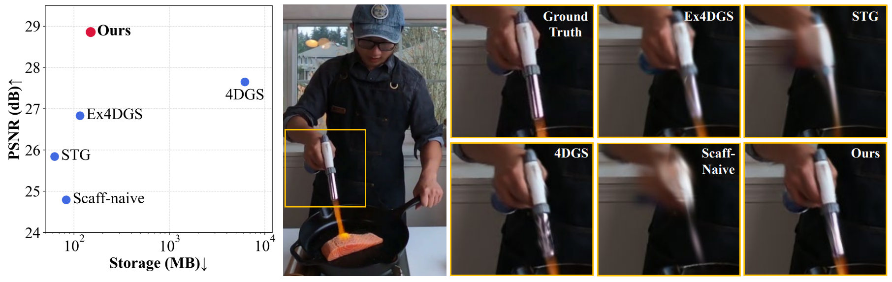
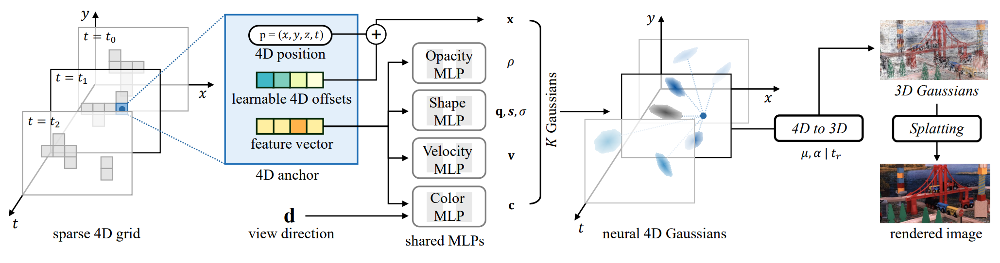

# 4D Scaffold Gaussian Splatting with Dynamic-Aware Anchor Growing for Efficient and High-Fidelity Dynamic Scene Reconstruction

[Woong Oh Cho](https://raikuma.github.io/), In Cho, Seoha Kim, Jeongmin Bae, Youngjung Uh, Seon Joo Kim <br />

[[`arxiv`](https://arxiv.org/abs/2411.17044)][[`project`](https://raikuma.github.io/4D-Scaffold-GS-Page/)]

> このREADMEは日本語版です。元の英語版READMEは [upstream (raikuma/4D-Scaffold-GS)](https://github.com/raikuma/4D-Scaffold-GS) を参照してください。

## 概要

「4D Scaffold Gaussian Splatting with Dynamic-Aware Anchor Growing for Efficient and High-Fidelity Dynamic Scene Reconstruction」の公式実装です。

<p align="center">

</p>

<p align="center">

</p>

## インストール

Ubuntu 20.04、CUDA 11.6のサーバーで動作確認しています。類似の構成であれば動作するはずですが、個別には検証していません。

1. このリポジトリをクローン:

```bash
git clone https://github.com/Kousei0329/4D-Scaffold-GS-research.git
cd 4D-Scaffold-GS-research
```

2. 依存関係をインストール

`environment.yml`の環境名は`4d_scaffold_naitive`です(このフォークでの変更点を参照)。

```bash
SET DISTUTILS_USE_SDK=1 # Windows only
conda env create --file environment.yml
conda activate 4d_scaffold_naitive
```

これで以下のCUDA拡張が全て自動的にビルドされます(`environment.yml`の`pip:`セクション経由)。

| 拡張 | 用途 |
|---|---|
| `submodules/diff-gaussian-rasterization` | ガウシアンのラスタライズ(本体、元々必要) |
| `submodules/simple-knn` | 最近傍探索(元々必要) |
| `submodules/gridencoder` | 圧縮機能のハッシュグリッド(後述、`--use_entropy_coding`時のみ使用) |
| `submodules/arithmetic` | 圧縮機能の算術符号化器(後述、`--use_entropy_coding`時のみ使用) |

3. (任意)ビルドが正しく通ったか確認:

```bash
python -c "import diff_gaussian_rasterization, simple_knn, _gridencoder, arithmetic; print('all extensions OK')"
```

いずれかで`ImportError`が出る場合は、該当のサブモジュールだけ個別に入れ直してください。

```bash
pip install ./submodules/gridencoder
pip install ./submodules/arithmetic
```

## データ

まず、プロジェクトディレクトリ内に```data/```フォルダを作成します。

```
mkdir data
```

N3DVデータセットの場合、データ構成は以下のようになります:

```
data/
├── N3DV/
│   ├── cook_spinach/
│   │   ├── images
│   │   │   ├── cam00_0000.png
│   │   │   ├── cam00_0001.png
│   │   │   ├── ...
│   │   ├── transforms_train.json
│   │   ├── transforms_test.json
│   │   ├── points3d.ply
│   ├── cut_roasted_beef/
│   │   ├── images
│   │   │   ├── cam00_0000.png
│   │   │   ├── cam00_0001.png
│   │   │   ├── ...
│   │   ├── transforms_train.json
│   │   ├── transforms_test.json
│   │   ├── points3d.ply
...
```

technicolorデータセットの場合は以下の通りです:

```
data/
├── technicolor_50/
│   ├── Birthday/
│   │   ├── images
│   │   │   ├── cam00
│   │   │   │   ├── 0000.png
│   │   │   │   ├── 0001.png
│   │   │   │   ├── ...
│   │   │   ├── cam01
│   │   │   │   ├── 0000.png
│   │   │   │   ├── 0001.png
│   │   │   │   ├── ...
│   │   ├── colmap
│   │   │   ├── dense
│   │   │   │   ├── workspace
│   │   │   │   │   ├── sparse
│   │   │   │   │   │   ├── cameras.bin
│   │   │   │   │   │   ├── images.bin
│   │   │   │   │   │   ├── points3D.bin
│   │   ├── points3D_downsample.ply
...
```

N3DVデータセットの前処理は[4DGS](https://github.com/fudan-zvg/4d-gaussian-splatting)の手順、technicolorデータセットの前処理は[E-D3DGS](https://github.com/JeongminB/E-D3DGS)の手順に従ってください。


## 学習

単一シーンを学習するには、```scripts/```フォルダ内の対応するスクリプトを実行します。例えば、N3DVデータセットの```cook_spinach```シーンを学習する場合:

```
bash ./scripts/train_n3dv.sh cook_spinach
```

このスクリプトは、ログ（実行時コードを含む）を```outputs/dataset_name/scene_name/exp_name/cur_time```に自動的に保存します。

`scripts/train_n3dv.sh`はデフォルトで複数のλ(圧縮の強さ)を順番に学習するレート歪み(RD)スイープになっています。中の`LAMBDAS=(...)`配列を編集すれば、試すλの値・個数を変更できます。単一のλだけで良い場合は配列を1要素にしてください。

## 圧縮(エントロピー符号化)

[HAC](https://github.com/YihangChen-ee/HAC) / [HAC++](https://github.com/YihangChen-ee/HAC-plus)を参考に、anchorのfeat/scaling/offsets、ハッシュグリッド、anchor座標(x,y,z,t)を実際に算術符号化してファイルサイズを縮める機能を追加しています。デフォルトでは無効(`--use_entropy_coding`を付けない限り、元の4D-Scaffold-GSと完全に同じ挙動)です。

有効にするには`train.py`に以下を追加します(`scripts/train_n3dv.sh`には既に付いています)。

```bash
python train.py ... --use_entropy_coding --lmbda 0.001
```

- `--lmbda`: 圧縮の強さ(大きいほど高圧縮・低画質寄り)。デフォルト`0.001`
- `--mask_prune_threshold`: 学習で「不要」と判断されたanchorを間引く閾値。デフォルト`0.01`
- `--hash_log2_size`: ハッシュグリッドのテーブルサイズ(2のべき乗)。デフォルト`19`

有効にすると、`point_cloud/iteration_N/`配下に通常の`point_cloud.ply`(無圧縮の生データ、互換性のため常に保存)に加えて、実際に圧縮された`bitstreams/`フォルダ(`feat.b`, `scaling.b`, `offsets.b`, `anchor_geom.b`など)と、1bitパック済みのハッシュグリッド`encoding_xyz.bin`が保存されます。学習完了時には、実際に圧縮ビットストリームから復号したモデルで`test/ours_{iteration}_compressed/`にレンダリング結果を保存し、通常の(無圧縮の)`test/ours_{iteration}/`と並べてSSIM/PSNR/LPIPS/ALEXを両方出力するので、圧縮による画質への影響をそのまま比較できます。

各`iteration`のログには、圧縮後の内訳サイズ(`feat`/`scaling`/`offsets`/`anchor`/`mask`/`hash_grid`/`mlps`の各MB、および合計)も出力されます。

## 評価

レンダリングと指標計算の処理は学習コードに統合済みです。そのため、学習が完了すると```rendering results```、```fps```、```quality metrics```が自動的に出力されます。レンダリング結果はログディレクトリに保存されます。```fps```は以下のようにおおまかに計測している点にご注意ください。

```
torch.cuda.synchronize();t_start=time.time()
rendering...
torch.cuda.synchronize();t_end=time.time()
```

これはオリジナルの3D-GSと多少異なる場合がありますが、分析には影響しません。

また、[3D-GS](https://github.com/graphdeco-inria/gaussian-splatting)の同等機能と同様の使い方で手動レンダリング機能も残しています。以下のように実行できます。

```
python render.py -m <path to trained model> # レンダリングを生成しfpsを計測
python metrics.py -m <path to trained model> # レンダリング結果の誤差指標を計算
```

## 連絡先

- Woong Oh Cho: wocho@yonsei.ac.kr

## 引用

この研究が役立った場合は、以下の引用をご検討ください:

```bibtex
@inproceedings{4dscaffoldgs,
  title={4D Scaffold Gaussian Splatting with Dynamic-Aware Anchor Growing for Efficient and High-Fidelity Dynamic Scene Reconstruction},
  author={Woong Oh Cho and In Cho and Seoha Kim and Jeongmin Bae and Youngjung Uh and Seon Joo Kim},
  booktitle={Arxiv},
  year={2025}
}
```

## LICENSE

[3D-GS](https://github.com/graphdeco-inria/gaussian-splatting)のLICENSEに従ってください。

## 謝辞

コードの大部分は**[Scaffold-GS](https://github.com/city-super/Scaffold-GS)**の優れた成果の上に構築されています。彼らの貢献に感謝します。

## このフォークでの変更点

上流（[raikuma/4D-Scaffold-GS](https://github.com/raikuma/4D-Scaffold-GS)）からフォークし、ヘッドレスサーバー（GUI/ディスプレイなしのDockerコンテナ、Python 3.7環境）で環境構築・N3DVデータセット学習を行う過程で発生したエラーに対応するため、以下を変更しています。

**2026-08-25**

- `environment.yml`
  - `defaults::pillow=9.4.0` / `defaults::libtiff=4.2.0` を明示的にピン留め。conda-forge由来のlibtiff（`.so.6`のみ提供）と、このPillowビルドが要求する`libtiff.so.5`のsoname不一致で`torchvision`のimportが失敗する問題への対処
  - `pip:`セクションに`jaxtyping`、`imagesize`を追加（コード実行時に必要だが記載が漏れていた依存パッケージ）
- `scene/dataset_readers.py`
  - `readNerfSyntheticInfo`内、`points3d.ply`が存在せずランダム初期点群にフォールバックする際の`BasicPointCloud(...)`呼び出しに、抜けていた`times=None`引数を追加（`TypeError: __new__() missing 1 required positional argument: 'times'`で学習開始前にクラッシュしていた）
- `scripts/train_n3dv.sh`
  - `num_workers`を`8`から`0`に変更。コンテナの`/dev/shm`が小さい（デフォルト64MB）環境で、DataLoaderのワーカープロセスが共有メモリ不足によりバスエラーで落ちる問題の回避策。`--shm-size`を十分な大きさ（例: 8GB以上）で確保できるコンテナ環境であれば、`8`に戻して問題ありません

**2026-09-01**

[HAC](https://github.com/YihangChen-ee/HAC) / [HAC++](https://github.com/YihangChen-ee/HAC-plus)を参考に、実際にファイルサイズを縮めるエントロピー符号化(圧縮)機能を追加しました。デフォルトでは無効(`--use_entropy_coding`を付けない限り、既存の動作に一切影響しません)。詳細は上記「圧縮(エントロピー符号化)」セクションを参照してください。

- `scene/gaussian_model.py`
  - 4分解ハッシュグリッド(xyz, xyt, xzt, yzt)によるコンテキストモデル(`mlp_grid`, `calc_interp_feat`)、anchorごとの適応的量子化幅、学習可能なレート歪みマスク(`_mask_anchor`)を追加
  - `conduct_encoding`/`conduct_decoding`: feat/scaling/offsetsの実算術符号化、ハッシュグリッドのBernoulli符号化、anchor座標(x,y,z,t)の4次元ハイパーオクツリー符号化を実装
- `utils/encodings.py`, `utils/entropy_models.py`, `utils/arithmetic_coding.py`, `utils/octree_coding.py`(新規)
  - HACから移植したハッシュグリッド実装・エントロピーモデル、および実際の算術符号化・4次元オクツリー符号化のユーティリティ
- `submodules/gridencoder`, `submodules/arithmetic`(新規、HACから移植)
  - ハッシュグリッドのCUDA実装、算術符号化器のCUDA実装。`environment.yml`の`pip:`セクションに追加済み
- `gaussian_renderer/__init__.py`, `train.py`
  - 学習時のレート歪み損失、量子化ノイズのウォームアップスケジュール、`saving_iterations`での実圧縮サイズのログ出力、学習終了時に実際に復号したモデルで`test/ours_{iteration}_compressed/`をレンダリング・評価する処理を追加
- `render.py`
  - `GaussianModel`構築時にentropy coding関連の引数を渡し忘れていたバグを修正(圧縮モデルの評価時に学習済みマスクが適用されず画質が大きく低下する原因になっていました)
- `scripts/train_n3dv.sh`
  - 複数のλ(圧縮の強さ)を順番に学習するレート歪み(RD)スイープに変更

**2026-10-28**

動的シーン(人物の動きなど)での再構成品質向上を狙った、モーションモデルのアブレーションと密度化トリガーの追加、およびいくつかの安定性バグ修正を行いました。デフォルトでは全て無効(既存の動作に影響なし)です。

- `--motion_model`: アンカーごとの動き表現を切り替えます(デフォルト`linear`)
  - `linear`: 元々の実装。学習された単一の速度ベクトルのみ(`xyz(t) = base + velocity・dt`)
  - `basis`: DynMF/TED-4DGS的な、学習済み時間基底との線形結合
  - `fourier`: 固定のsin/cos調和基底との線形結合(学習パラメータなし)
  - `taylor_residual`: 速度・加速度・躍度(3次多項式)+学習済み基底による残差補正。`dt`と最終変位をクランプしており(詳細はコード内コメント参照)、これがないと訓練中に稀に発散し、視錐台外にアンカーが押し出されてクラッシュすることがあります
- `--motion_sigma_reg_weight`(デフォルト`0.0`): 動きが速い領域ほどtemporal opacityの時間窓を狭める正則化損失の重み。実験では`0.002`〜`0.003`程度で複数シーンにおいてbaselineをPSNR・サイズ両面で上回る結果が得られています。大きすぎる値(`0.01`など)は背景領域の品質を犠牲にするので注意
- `--flow_densify_threshold`(デフォルト`0.0`): `--photo_densify_threshold`と同じ仕組みの追加密度化トリガーで、写真誤差ではなく平均的な動きの速さ(flow速度)が閾値を超えたオフセットを成長候補に加えます
- `--disable_mip_filter`: Mip-Splatting風の3Dフィルタ(`compute_3D_filter`、学習カメラ集合から決定論的に計算される分散フロア)を無効化します
- `render_cached`/`render()`: N3DV/Neu3Dのテストプロトコル(同一カメラ・複数タイムスタンプ)向けに、カメラが変わらない限りアンカーのneural-Gaussian出力をキャッシュして再利用するようになりました
- `--use_joint_4d_hash`: (x, y, z, t)を1つのハッシュグリッドで扱う4次元ジョイントハッシュのオプションを追加(`submodules/gridencoder`のcase 4を有効化)
- 安定性バグ修正(いずれも実際に再現したクラッシュへの対処)
  - `ChannelCtxFeat.forward`/`forward_grid`にNaN/Infのファイアウォール(`nan_to_num`)を追加
  - `train.py`の`CUDA_VISIBLE_DEVICES`自動選択(起動時に最も空いているGPUを選ぶ処理)が、明示的に`--gpu`を指定した場合でも無条件に実行されていたバグを修正。2つのジョブをほぼ同時に起動すると、運悪く同じ物理GPUを選んでしまい競合することがありました
  - 学習終了時の`evaluate()`(LPIPS計算)の直前に`torch.cuda.empty_cache()`を追加。学習ループの未解放メモリが原因のOOMクラッシュに対処
- `arithmetic_coding.py`/`entropy_models.py`/`octree_coding.py`: 2成分ガウス混合事前分布の実際の算術符号化(`encode_gaussian_mixed`等)と、オクツリーマスクのコンテキスト条件付きビット推定を追加
